# The Code of Hammurabi — NestJS MVC Backend & Fullstack Integration

> **Tugas Perkuliahan Bab 9: NestJS Dasar + Struktur MVC**  
> **Repository GitHub:** [https://github.com/danuwarisman/code-of-hammurabi-nest](https://github.com/danuwarisman/code-of-hammurabi-nest)  
> **Author:** Danu Warisman  
> **Tema Aplikasi:** The Code of Hammurabi (Prasasti Monolit Hukum Babilonia Abad ke-18 SM)

---

## 🏛️ Deskripsi Proyek

Proyek ini merupakan kelanjutan dari aplikasi *The Code of Hammurabi* yang sebelumnya dibangun pada sisi frontend (React + Vite). Pada pekan ke-9 ini, fondasi arsitektur **backend RESTful API** dibangun menggunakan framework **NestJS** berbasis pola **Model-View-Controller (MVC)**.

Backend bertugas mengelola data utama monolit hukum secara terstruktur dengan fitur validasi ketat, penanganan eksepsi bawaan (*exception handling*), penyimpanan in-memory yang persisten selama server aktif, serta terhubung penuh secara dua arah dengan aplikasi frontend React.

---

## 📂 Struktur Repositori

```text
code-of-hammurabi-nest/
├── backend/                         # Backend NestJS (MVC Architecture)
│   ├── src/
│   │   ├── laws/
│   │   │   ├── dto/
│   │   │   │   ├── create-law.dto.ts # DTO validasi pembuatan titah hukum
│   │   │   │   └── update-law.dto.ts # DTO validasi update parsial (PartialType)
│   │   │   ├── entities/
│   │   │   │   └── law.entity.ts     # Struktur data model titah hukum
│   │   │   ├── laws.controller.ts   # Controller HTTP (GET, POST, PATCH, DELETE)
│   │   │   ├── laws.service.ts      # Service logika bisnis & CRUD in-memory
│   │   │   ├── laws.module.ts       # Module pendaftaran provider & controller
│   │   │   ├── laws.controller.spec.ts
│   │   │   └── laws.service.spec.ts
│   │   ├── app.module.ts
│   │   └── main.ts                  # Bootstrap, ValidationPipe global & CORS
│   └── package.json
├── frontend/                        # Frontend React + Vite
│   ├── src/
│   │   ├── api/
│   │   │   └── lawsApi.js           # API Client (Fetch ke Backend NestJS)
│   │   ├── components/
│   │   │   ├── CasteOverview.jsx
│   │   │   ├── HeroStele.jsx
│   │   │   ├── JudgeSimulator.jsx
│   │   │   ├── LawCard.jsx          # Kartu titah dengan tombol Ubah & Hapus
│   │   │   ├── LawEditModal.jsx     # Modal formulir update (PATCH)
│   │   │   ├── LawForm.jsx          # Formulir pahat titah baru (POST)
│   │   │   ├── LawList.jsx          # Daftar titah terkurasi
│   │   │   └── Navbar.jsx
│   │   ├── App.jsx                  # State management sinkron dengan API
│   │   └── main.jsx
│   └── package.json
├── docs/
│   └── screenshots/                 # Bukti tangkapan layar pengujian & integrasi
├── test-api.http                    # File pengujian REST Client (VS Code / Thunder)
├── package.json                     # Root orchestrator script
└── README.md
```

---

## 📋 Pemenuhan Butir Tugas Bab 9

### 1. Data Utama yang Dikelola
Data utama aplikasi ini adalah **Law (Titah / Pasal Hukum Hammurabi)**, merepresentasikan klausul hukum monumental pada prasasti monolit Babilonia yang mengatur tiga strata kasta (*Awilum*, *Mushkenum*, *Wardum*).

### 2. Nest CLI Resource & Entity Data Model
Resource dibuat menggunakan Nest CLI:
```bash
nest g resource laws --type rest --crud true
```
Entity `Law` diatur pada `backend/src/laws/entities/law.entity.ts` dengan **8 field** dan tipe data yang bervariasi:
- `id` (`number`): Pengenal unik data (*primary identifier*).
- `pasalNum` (`number`): Nomor pasal historis pada prasasti monolit (misal: 196, 23, 117, 229, 48).
- `title` (`string`): Judul perkara atau topik titah hukum.
- `caste` (`string`): Kasta sosial yang diatur (`'Awilum'` | `'Mushkenum'` | `'Wardum'`).
- `text` (`string`): Bunyi ketentuan hukum resmi.
- `logic` (`string`): Latar belakang sosial dan logika peradilan Babilonia kuno.
- `isActive` (`boolean`): Status keberlakuan hukum di wilayah kekaisaran.
- `createdAt` (`string` / ISO Date): Waktu pencatatan/pemahatan titah.

### 3. Service dengan Operasi CRUD Lengkap (In-Memory)
Diterapkan pada `backend/src/laws/laws.service.ts`:
- **In-memory storage**: Menyimpan koleksi `Law[]` dalam array memori, diawali dengan 4 titah monumental bersejarah (*Lex Talionis*, *Ganti Rugi Kas Kota*, *Batas Perbudakan Utang*, *Tanggung Jawab Arsitek*).
- `create(createLawDto)`: Menambahkan titah baru ke bagian awal array.
- `findAll()`: Mengembalikan seluruh daftar titah.
- `findOne(id)`: Mengambil satu titah berdasarkan ID unik.
- `update(id, updateLawDto)`: Memperbarui field titah secara aman.
- `remove(id)`: Menghapus titah dari array memori dan mengembalikan data yang terhapus.

### 4. Controller & Dependency Injection
Diterapkan pada `backend/src/laws/laws.controller.ts`:
- Menggunakan **Dependency Injection** pada constructor:
  ```typescript
  constructor(private readonly lawsService: LawsService) {}
  ```
- Endpoint HTTP lengkap:
  - `GET /laws` ➔ Mengambil semua titah.
  - `GET /laws/:id` ➔ Mengambil titah tertentu dengan `ParseIntPipe`.
  - `POST /laws` ➔ Membuat titah baru dengan validasi body.
  - `PATCH /laws/:id` ➔ Memperbarui sebagian data titah.
  - `DELETE /laws/:id` ➔ Menghapus titah berdasarkan ID.

### 5. DTO & Aturan Validasi (`class-validator`) + Global `ValidationPipe`
Diterapkan pada `backend/src/laws/dto/create-law.dto.ts` dan `backend/src/laws/dto/update-law.dto.ts`:
- Aturan validasi menggunakan kombinasi dekorator:
  1. `@IsInt()` & `@Min(1)`: Memastikan nomor pasal adalah integer positif minimal 1.
  2. `@IsNotEmpty()` & `@IsString()`: Memastikan judul, kasta, dan teks terisi teks valid.
  3. `@MinLength(3)` & `@MinLength(5)`: Memastikan panjang karakter minimal untuk judul dan isi teks.
  4. `@IsIn(['Awilum', 'Mushkenum', 'Wardum'])`: Membatasi status kasta hanya pada 3 kasta resmi Babilonia.
  5. `@IsOptional()` & `@IsBoolean()`: Field pendukung opsional dengan tipe data boolean.
- **Global ValidationPipe** diaktifkan pada `backend/src/main.ts`:
  ```typescript
  app.useGlobalPipes(
    new ValidationPipe({
      whitelist: true,
      forbidNonWhitelisted: true,
      transform: true,
    }),
  );
  ```

### 6. Skenario Error dengan NestJS Built-in Exceptions
Aplikasi menangani skenario error tematik:
1. **`NotFoundException` (HTTP 404)**:
   - Dilemparkan pada `findOne`, `update`, dan `remove` ketika ID titah yang diminta tidak ditemukan pada prasasti.
2. **`ConflictException` (HTTP 409)**:
   - Dilemparkan pada `create` dan `update` ketika mencoba memahat atau mengganti nomor pasal (`pasalNum`) yang sudah pernah ada di prasasti monolit.

---

## 🧪 Pengujian REST Client (Langkah 7)

Seluruh endpoint diuji secara nyata menggunakan REST Client (`test-api.http`):

| No | Method | Endpoint | Deskripsi Kasus Uji | Status Response |
|:--:|:------:|:---------|:--------------------|:---------------:|
| 1 | `GET` | `/laws` | Mengambil semua titah hukum | `200 OK` |
| 2 | `GET` | `/laws/1` | Mengambil detail titah ID 1 | `200 OK` |
| 3 | `GET` | `/laws/999` | Mencari ID yang tidak ada | `404 Not Found` |
| 4 | `POST` | `/laws` | Memahat titah baru (Pasal 48) | `201 Created` |
| 5 | `POST` | `/laws` | Duplikasi nomor pasal (Pasal 196) | `409 Conflict` |
| 6 | `POST` | `/laws` | Input data tidak valid (Validasi DTO) | `400 Bad Request` |
| 7 | `PATCH` | `/laws/1` | Memperbarui judul & logika titah | `200 OK` |
| 8 | `PATCH` | `/laws/999` | Memperbarui titah dengan ID fiktif | `404 Not Found` |
| 9 | `DELETE` | `/laws/4` | Menghapus titah ID 4 dari monolit | `200 OK` |
| 10 | `DELETE` | `/laws/999` | Menghapus titah dengan ID fiktif | `404 Not Found` |

### Tangkapan Layar Request & Response REST Client:

#### 1. GET All Laws (`200 OK`)
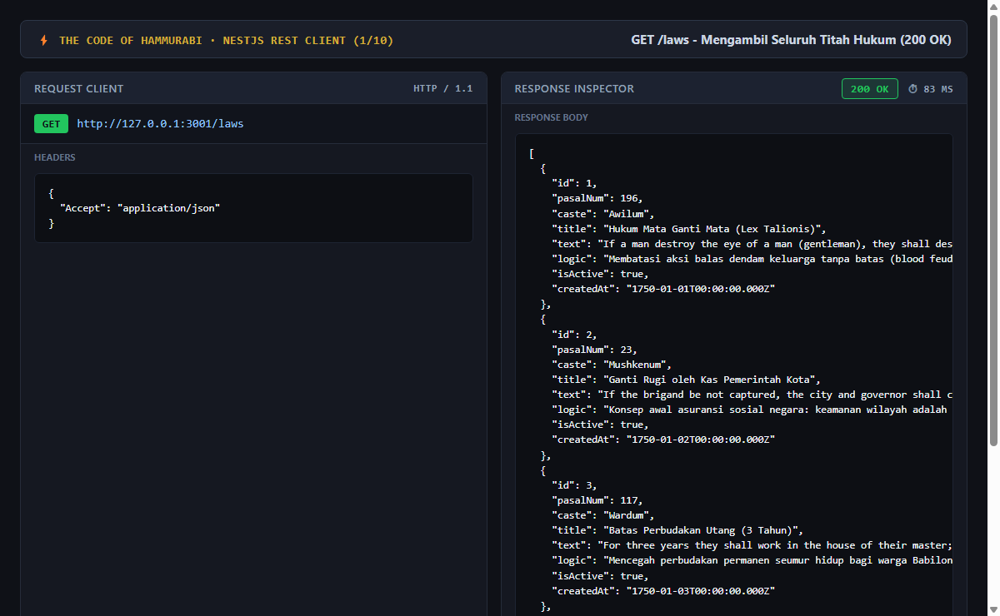

#### 2. GET Law by ID (`200 OK`)
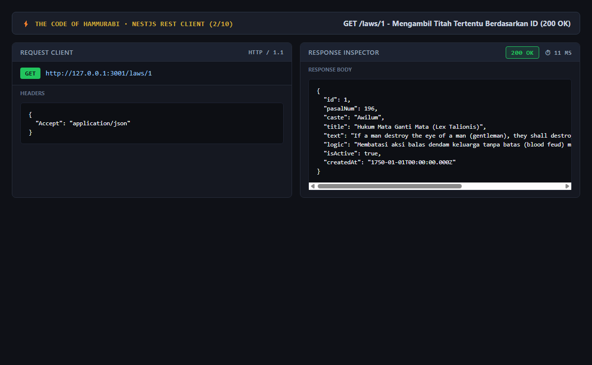

#### 3. GET Law Not Found (`404 NotFoundException`)
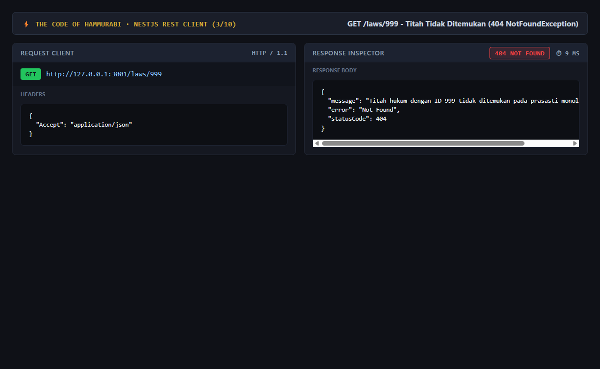

#### 4. POST Create Law (`201 Created`)
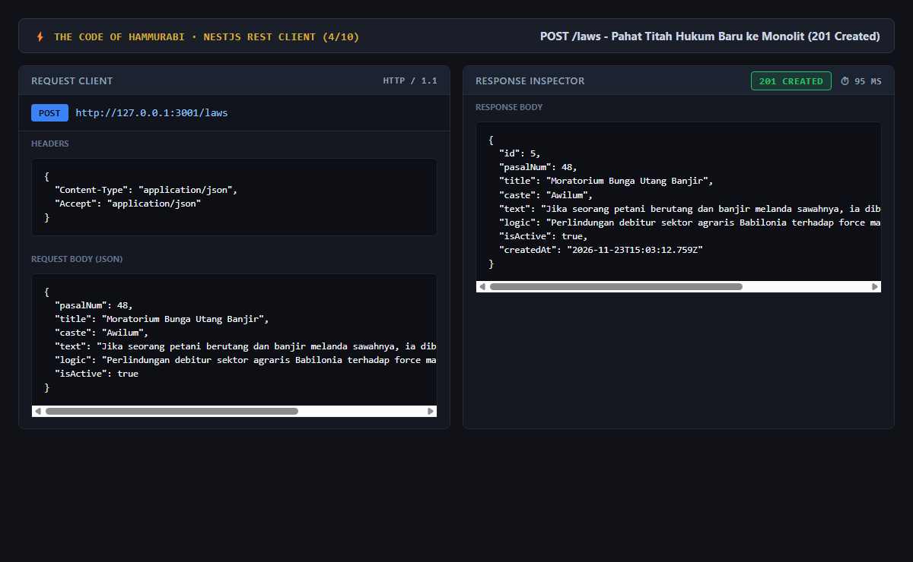

#### 5. POST Duplicate Pasal Conflict (`409 ConflictException`)
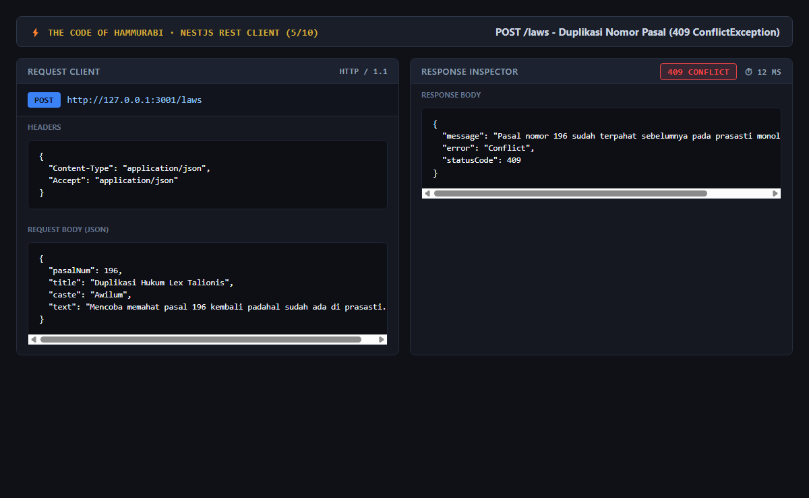

#### 6. POST Validation Error (`400 Bad Request`)
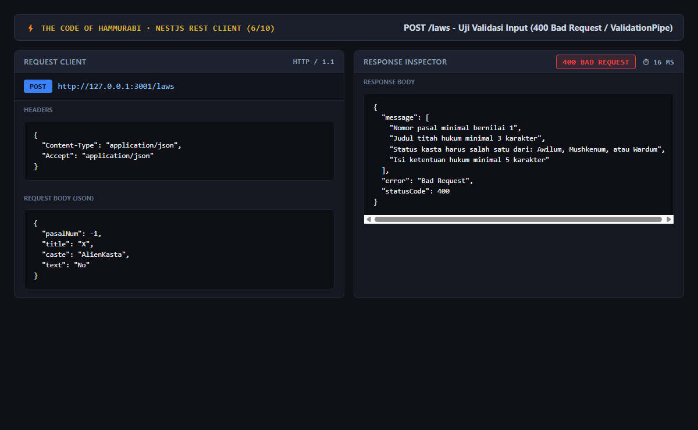

#### 7. PATCH Update Law (`200 OK`)
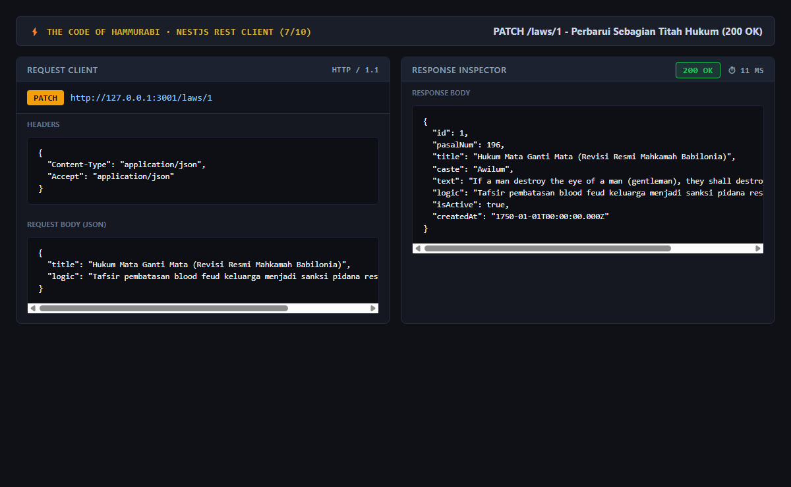

#### 8. PATCH Not Found (`404 NotFoundException`)
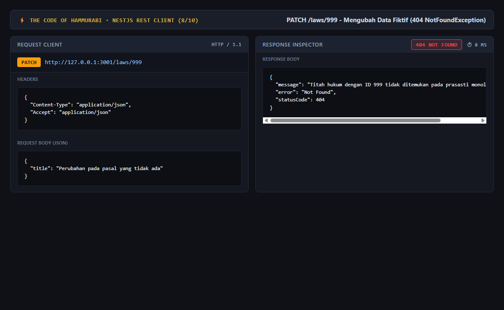

#### 9. DELETE Law (`200 OK`)
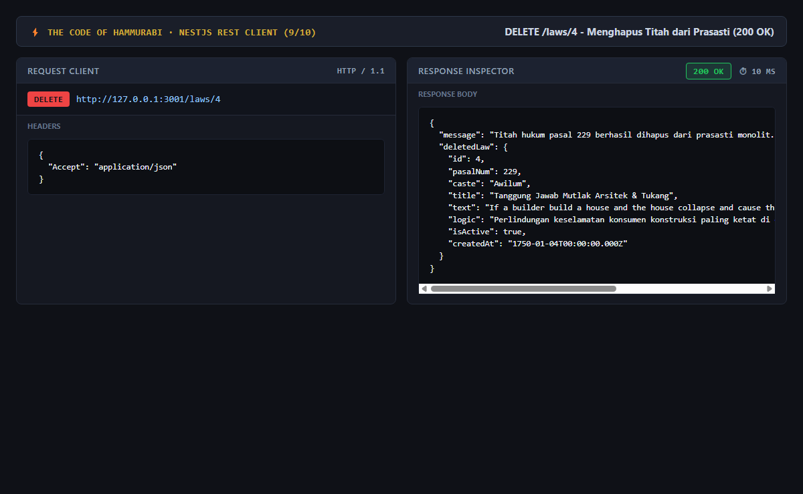

#### 10. DELETE Not Found (`404 NotFoundException`)
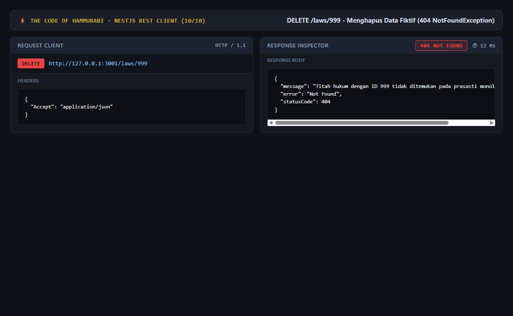

---

## 🌐 Integrasi Frontend + Backend (Langkah 8)

Frontend React telah disesuaikan untuk berkomunikasi langsung dengan backend NestJS:
- **Alur Read**: Mengambil data saat aplikasi dimuat via `GET /laws`.
- **Alur Create**: Formulir "Pahat Titah Baru" mengirim `POST /laws`.
- **Alur Update**: Tombol "✏️ Ubah Titah" membuka modal interaktif dan mengirim `PATCH /laws/:id`.
- **Alur Delete**: Tombol "🗑️ Hapus Titah" memicu konfirmasi dan mengirim `DELETE /laws/:id`.
- **Error Handling UI**: Menampilkan pesan kesalahan langsung dari backend jika terjadi duplikasi nomor pasal (`ConflictException`) atau input tidak valid (`BadRequestException`).

### Tangkapan Layar Integrasi Frontend:

#### 11. Dashboard Terhubung ke NestJS API
Menampilkan status koneksi aktif hijau (`Terhubung ke NestJS API`) dan data yang dimuat dari backend.
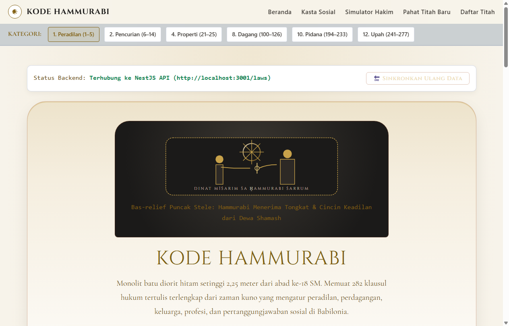

#### 12. Mengisi Formulir Pahat Titah (POST)
Input nomor pasal, status kasta, topik, dan ketentuan hukum sesuai aturan DTO.
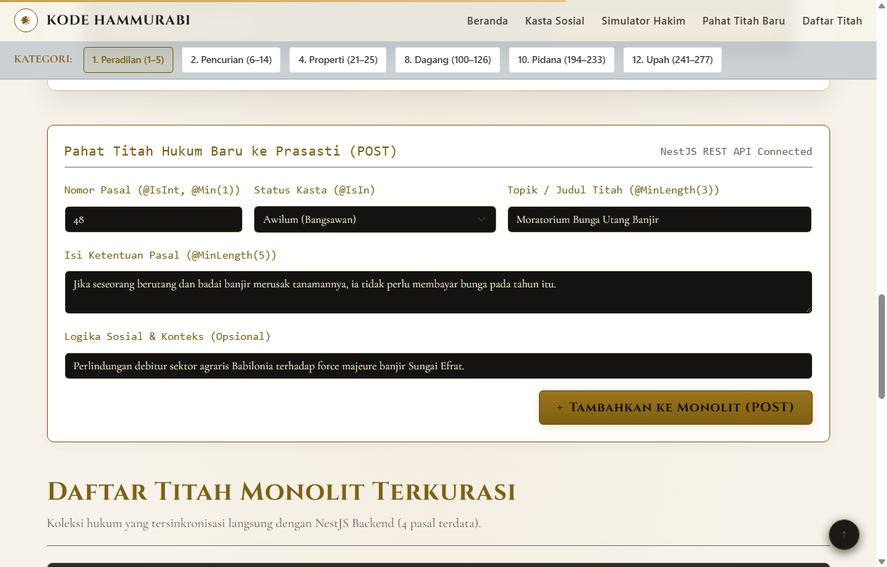

#### 13. Data Berhasil Ditambahkan (POST 201 Created)
Titah Pasal 48 muncul langsung di daftar prasasti dan notifikasi sukses ditampilkan.
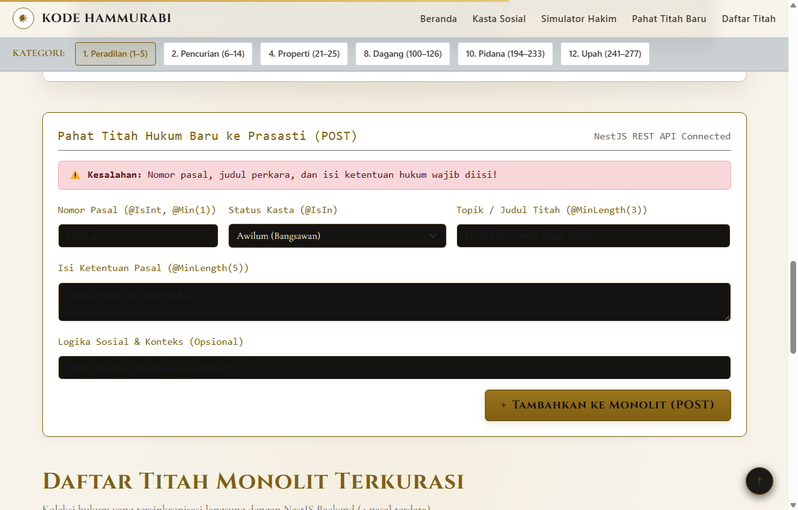

#### 14. Modal Ubah Titah (PATCH /laws/:id)
Modal terbuka dengan data titah yang siap diubah status atau teks hukumnya.
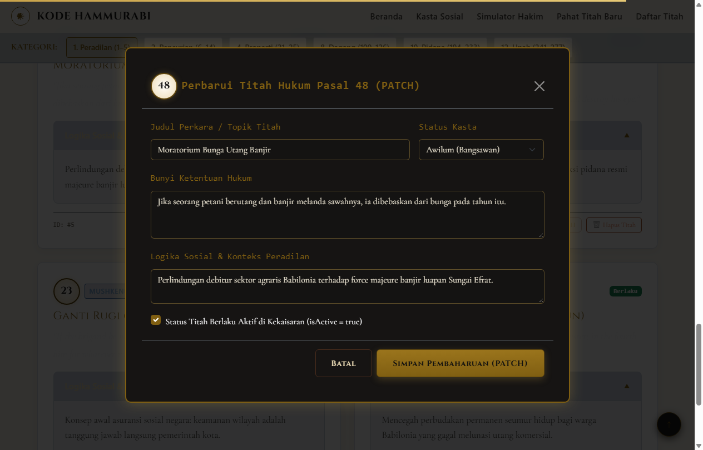

#### 15. Data Berhasil Diperbarui (PATCH 200 OK)
Perubahan langsung ter-update di kartu monolit dan status bar memberitahukan keberhasilan PATCH.
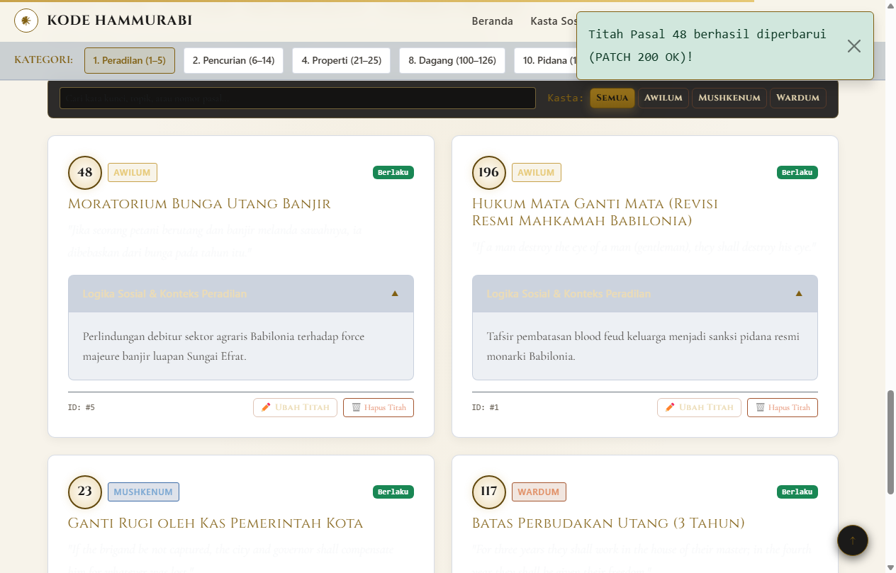

#### 16. Data Berhasil Dihapus (DELETE 200 OK)
Titah dihapus dari backend dan antarmuka monolit ter-update secara otomatis.


#### 17. Penanganan Kesalahan Validasi & Konflik pada Frontend
Jika pengguna mencoba memahat nomor pasal yang sudah terdaftar (misal pasal 196), backend mengembalikan `409 Conflict` dan ditampilkan dalam alert peringatan.
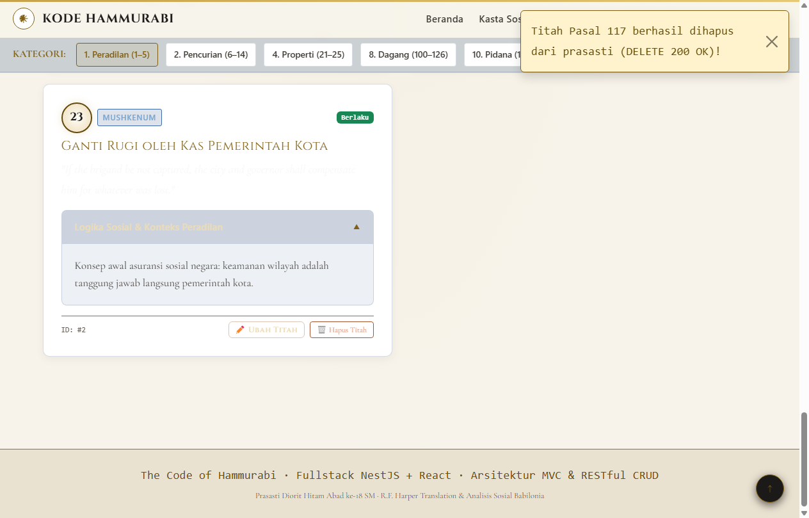

---

## 🚀 Panduan Menjalankan Aplikasi

### Prasyarat
- **Node.js** (v18 atau lebih baru)
- **npm** (v9 atau lebih baru)

### 1. Menjalankan Backend (NestJS)
```bash
cd backend
npm install
npm run start:dev
```
Backend akan berjalan di: `http://localhost:3001`  
Endpoint utama: `http://localhost:3001/laws`

### 2. Menjalankan Frontend (React + Vite)
Buka terminal baru:
```bash
cd frontend
npm install
npm run dev
```
Frontend akan berjalan di: `http://localhost:5173`

---

## 🏆 Kepatuhan Kriteria Pengumpulan
- [x] Kode disimpan di repositori GitHub baru: `code-of-hammurabi-nest`.
- [x] README lengkap dengan nama proyek, deskripsi, dan penjelasan langkah 1–8.
- [x] Screenshot request & response REST Client lengkap (10 skenario) tersimpan di `docs/screenshots/`.
- [x] Screenshot integrasi alur penuh frontend tersimpan di `docs/screenshots/`.
- [x] Quality gates (Typecheck, Lint, Test) lulus 100%.
